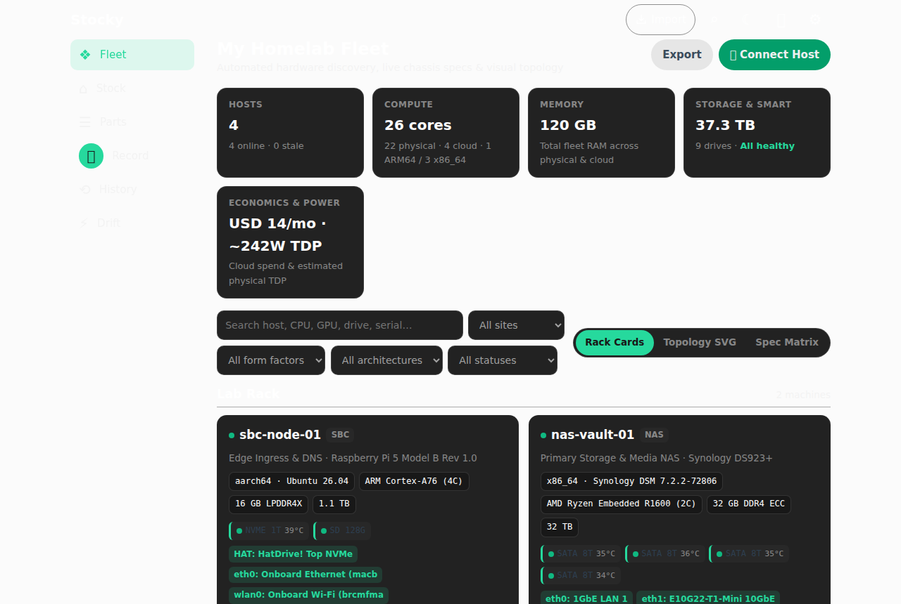
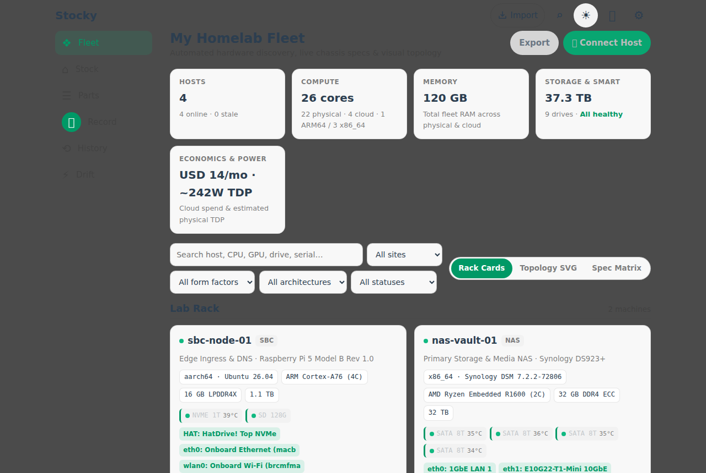
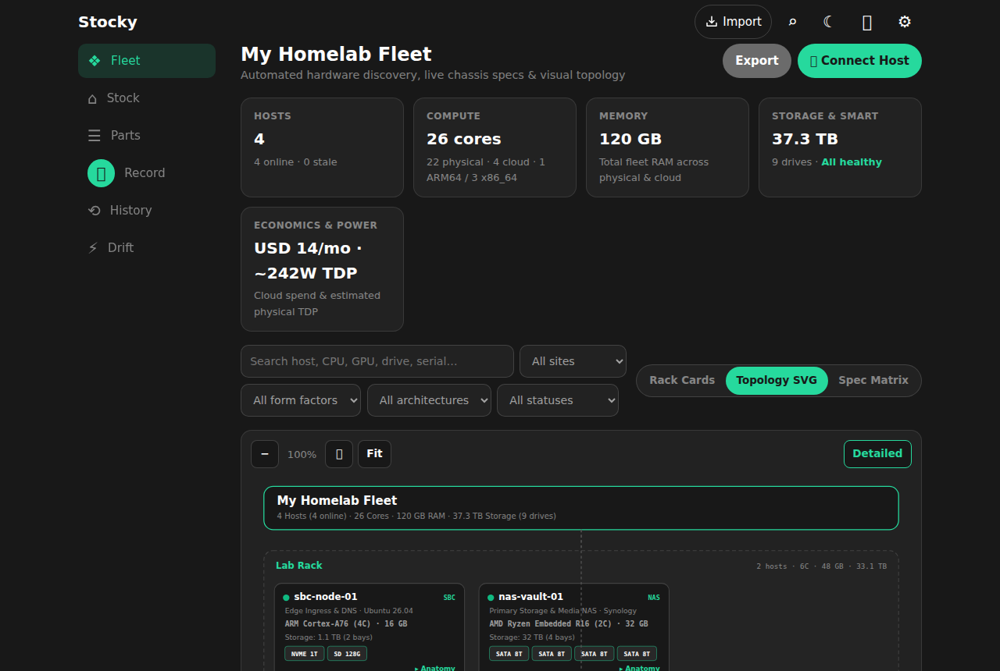
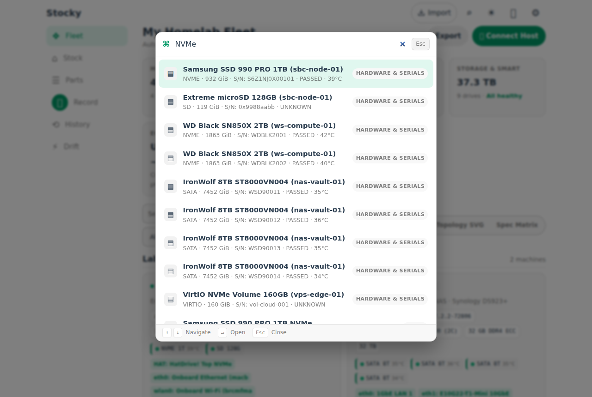
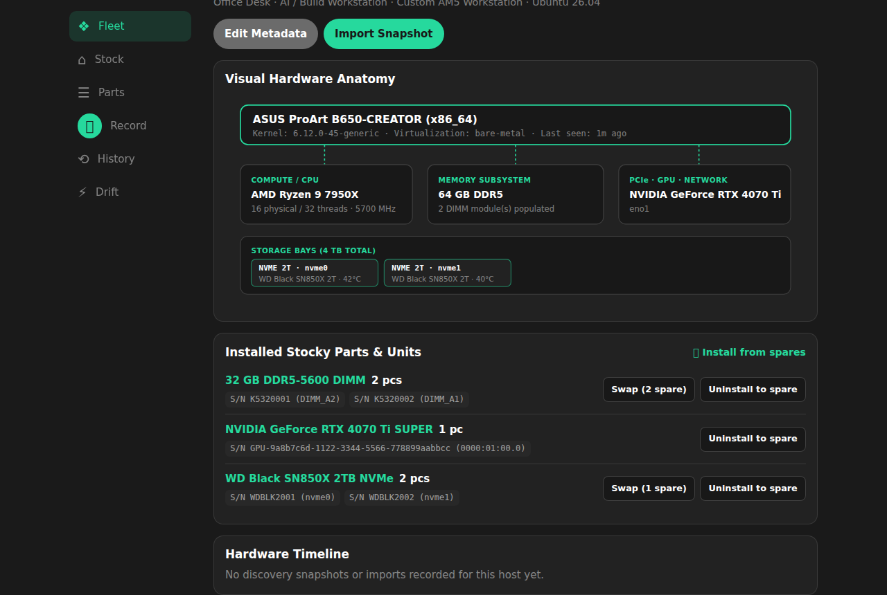
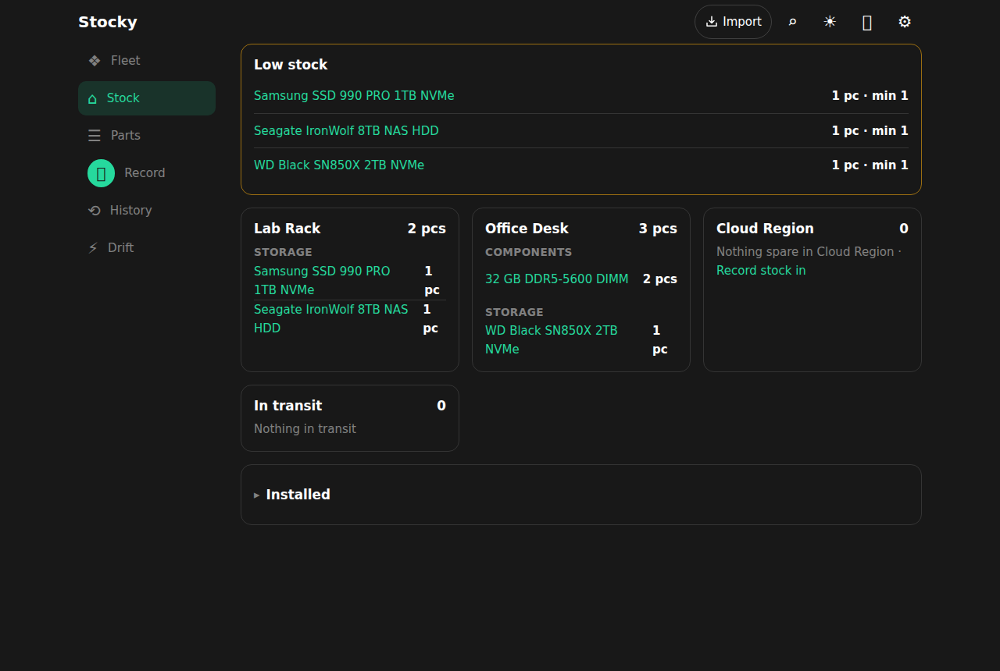

# Stocky

[](https://github.com/hexawulf/stocky/actions/workflows/ci.yml)
[](https://hub.docker.com/r/0xwulf/stocky)
[](https://hub.docker.com/r/0xwulf/stocky)
[](LICENSE)

**Auto-discover every machine in your fleet, visualize your entire hardware topology, and track every spare part and swap in one self-hosted container.**

Stocky is a mobile-first, self-hosted homelab hardware tracker and spare parts ledger:
spare parts at one or more sites, what's on its way between them (In transit),
what's installed in which machine, and a live visual representation of your entire
hardware fleet. Every stock change is a dated movement, validated on the server in
one transaction, and the most recent movement or discovery import can be undone within
24 hours.

It runs as **one Docker container**: [PocketBase](https://pocketbase.io)
(auth, SQLite, API rules, realtime SSE) serving a Vue 3 app. No cloud services, no external dependencies.

<p align="center">
  
  &nbsp;&nbsp;
  
</p>

<p align="center">
  
  &nbsp;&nbsp;
  
</p>

<p align="center">
  
  &nbsp;&nbsp;
  
</p>

## What's new in v1.1.0

- **Global `⌘K` / `Ctrl+K` Command Palette:** Instant fuzzy search from any screen (`⌘K`, `Ctrl+K`, or top-bar `⌕` button) across every **Host**, physical **Drive by Serial Number**, **GPU**, **NIC MAC / IPv4**, **Part Type**, and **Quick Actions**.
- **Light / Dark / System Theme Toggle:** 1-click top-bar theme switcher (`☀` / `☾`) plus a `System / Light / Dark` selector in Settings (`/settings`).
- **Fleet-First Navigation:** **Fleet** (`/` and `/fleet`) is now the primary landing view, with **Stock** (`/stock` — spare stock per site, low-stock alerts, and installed units) second in the navigation bar.
- **Hardened Multi-Platform Discovery (`stocky-collect.sh` v2.0 + `stocky-fleet-pull.sh`):** First-class support for bare-metal Linux, Raspberry Pi 4/5 (`arm64`), Cloud KVM VPSes, Synology DSM NASes (`synoinfo.conf` + `/sys/block` + Synology `smartctl`), and Windows WSL2 hosts (`/usr/lib/wsl/lib/nvidia-smi`).

## What it does

- **Visual Fleet Hardware Overview (`/` & `/fleet`):**
  - **KPI Summary Strip:** Live host freshness (online / stale / drift), total physical & cloud cores (`ARM64` vs `x86_64`), total RAM, total storage & SMART drive health warnings, plus optional monthly cloud spend and physical TDP power estimate.
  - **3 Switchable Visual Modes:**
    1. **Rack & Chassis View:** Hardware chassis cards grouped by Site with form-factor badges (`SBC`, `Workstation`, `NAS`, `Cloud VPS`, `Server`), CPU/RAM/OS chips, visual drive-bay slots (`NVMe`, `SATA`, `VirtIO`, `SD`) with SMART health LEDs and temperatures, plus GPU/HAT/NIC chips.
    2. **Interactive Fleet Topology SVG:** Pure Vue-rendered hierarchical SVG diagram (Fleet Root → Site Zones → Host Nodes → expandable Tier-3 Hardware Anatomy sub-nodes) with zoom, fit, and compact/detailed toggles.
    3. **Spec Comparison Matrix:** Sortable spec table comparing every host across Site, Form Factor, Arch/OS, CPU/Cores, RAM, Storage, GPUs, NICs, SMART status, Monthly Cost, and Last Seen.
- **Host Detail Inspector (`/fleet/:id`):** Visual Hardware Anatomy block diagram (SVG), Stocky-tracked installed units with serial numbers, 1-click **"Swap with spare"** or **"Uninstall to spare"**, chronological Hardware Timeline, and Quick Metadata Editor.
- **Automated Fleet Discovery (`stocky-collect.sh` v2.0 & `stocky-fleet-pull.sh`):**
  - Collects bare-metal Linux, Raspberry Pi / ARM64 SBCs, Cloud KVM VPSes, Synology DSM NASes, and WSL2 hosts (`stocky.discovery/2`, full backward compatibility with `stocky.discovery/1`).
  - Captures CPU cores, RAM modules, drives with SMART status/temperature/wear, GPUs (`nvidia-smi` / `lspci`), physical NICs, USB devices, and Pi HAT EEPROMs.
  - Supports automated push (`--push <URL> --token-file <PATH>`) using SHA-256 hashed scoped ingest tokens (`stky_...`), central read-only SSH pull (`tools/stocky-fleet-pull.sh`) for isolated NAS/LAN nodes, or offline JSON upload.
  - Ready-to-install `cron` and `systemd` user timer generators (`--print-cron`, `--print-systemd`), with `stocky-collect.sh` and its `.sha256` checksum served directly from `/tools/stocky-collect.sh` on every Stocky container.
- **Zero-Noise Drift Inbox (`/fleet/drift`):** Automatic snapshots update harmless telemetry (`lastSeenAt`, OS/kernel, SMART temps) live while queuing physical hardware changes (added NVMe, swapped RAM, missing drive) in the Drift Inbox for 1-click transactional confirmation.
- **Privacy-Safe Visual & Spec Exports:** Export your fleet as standalone **SVG**, **2× High-DPI PNG**, **Markdown spec table**, or **JSON** — with **Privacy Redaction ON by default** (strips serial numbers, MAC addresses, `machineIdHash`, and optional host anonymization).
- **Parts, Movements & History:** Catalog of part types (`pcs`, `sheets`, `m`), spare stock per site and In transit, low-stock alerts, unit prices (`TWD`, `EUR`, `USD`), append-only transactional movements, and 24-hour undo.
- **Frictionless Onboarding, `⌘K` Command Palette & Appearance:** Global `⌘K` / `Ctrl+K` Command Palette (instant fuzzy search across hosts, drive serials, GPUs, NIC MAC/IPs, parts, and actions), built-in `standard`, `example`, and `demo_fleet` presets, a **Load Demo Fleet** button on empty instances, and instant **Light / Dark / System** theme switching.

## Run it

```sh
mkdir -p pb_data                      # writable by uid/gid 1000
docker run -d --name stocky --restart unless-stopped \
  -p 127.0.0.1:5030:8080 -v "$PWD/pb_data:/pb/pb_data" 0xwulf/stocky:latest
docker exec -it stocky /pb/pocketbase superuser upsert you@example.com 'a-long-password'
```

Then open `http://127.0.0.1:5030/_/` (the PocketBase dashboard), create your
user account (there's no public sign-up), and sign in at
`http://127.0.0.1:5030/`. For HTTPS, a reverse proxy, mail and backups see
[docs/deploy.md](docs/deploy.md); for seed presets,
[docs/presets.md](docs/presets.md).

Images are built for `linux/amd64` and `linux/arm64` (Raspberry Pi 4/5).
Tags: `X.Y.Z`, `X.Y` and `latest`; what changed is in [CHANGELOG.md](CHANGELOG.md).

## Discovery collector

```sh
# 1. Automated push to Stocky (recommended — see "＋ Connect Host" in the UI):
tools/stocky-collect.sh --push https://stocky.example.com --token-file ~/.config/stocky/ingest.token

# 2. Central read-only SSH pull (for Synology NAS or isolated nodes):
tools/stocky-fleet-pull.sh -c ~/.config/stocky/hosts.conf \
  --push https://stocky.example.com --token-file ~/.config/stocky/ingest.token

# 3. Offline JSON snapshot:
tools/stocky-collect.sh -o "$(hostname).json"   # then upload in Stocky → Import
```

Read-only, plain POSIX Bash, no extra packages required. See
[tools/README.md](tools/README.md) and the schema in
[docs/discovery-schema.json](docs/discovery-schema.json).

## Develop

Node `^22.18` or `>=24.12`, and the PocketBase binary (pinned version in the
Dockerfile) for the server and E2E suites.

```sh
npm install
npm run dev                      # Vite; /api and /_ proxy to PocketBase on 127.0.0.1:8090
npm test                         # unit and component tests (Vitest)
npm run test:api -- --download   # all server + collector suites against throwaway PocketBase instances
npm run test:e2e                 # Playwright Chromium E2E smoke suite against built dist/ + PocketBase
docker build -t stocky:dev .
```

- `src/`: the Vue 3 app (plain composables for state, vue-router).
- `pb_migrations/`, `pb_hooks/`: collections, API rules and server routes.
- `e2e/`: Playwright Chromium E2E smoke tests.
- `SECURITY.md`: security policy and threat model.
- `spec.md`: full technical specification and decision log.

## License

[MIT](LICENSE)
