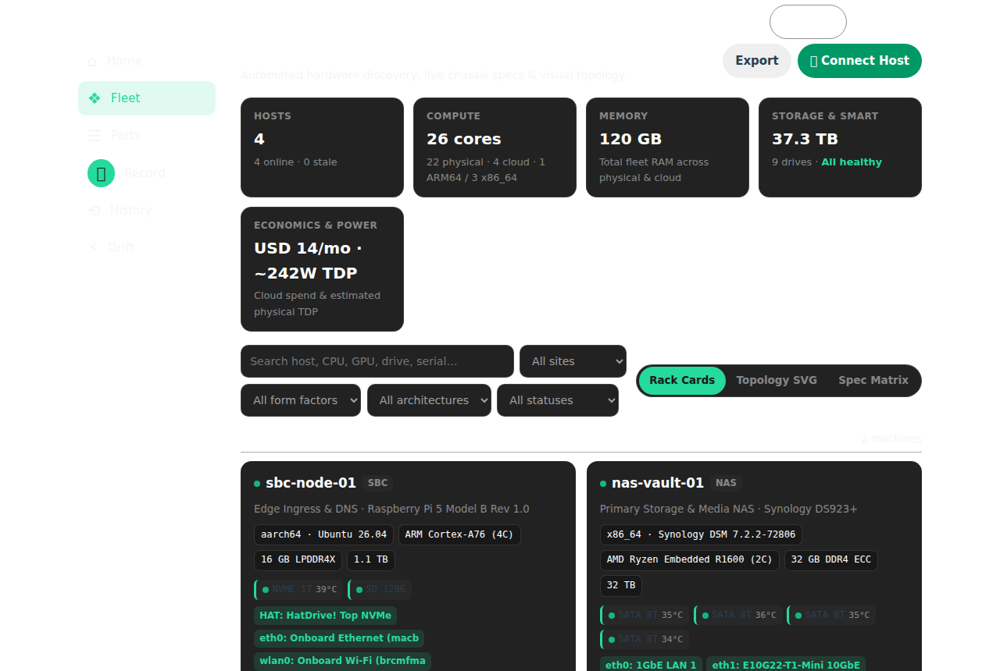
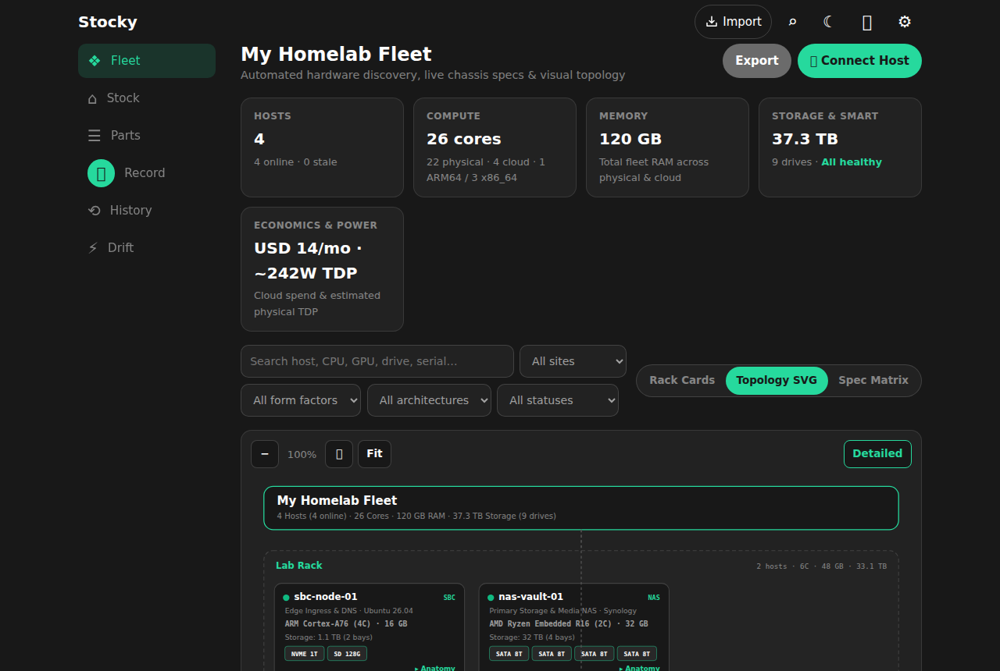
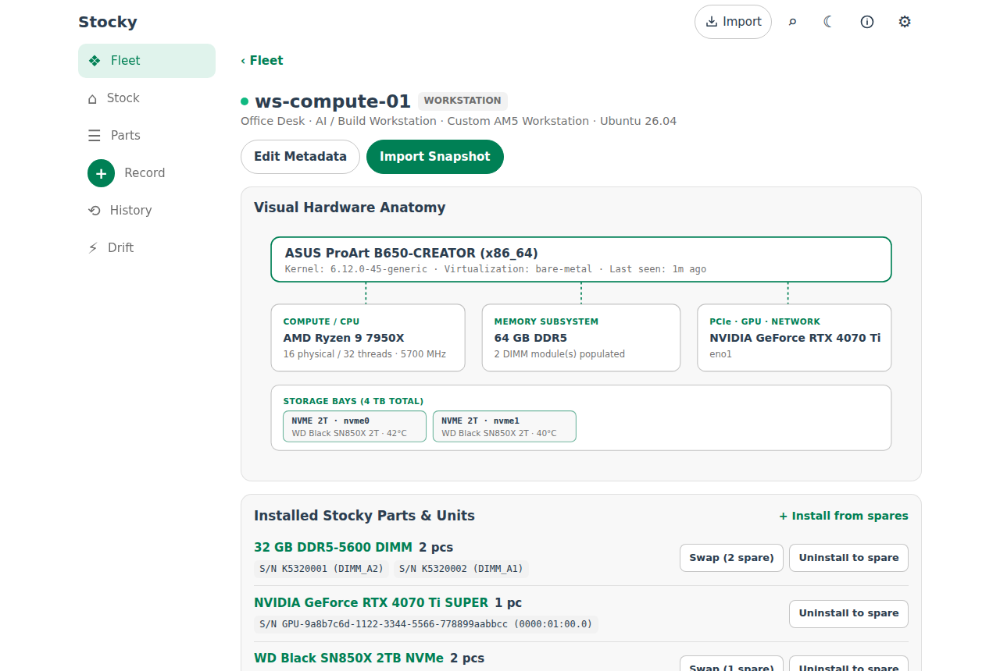
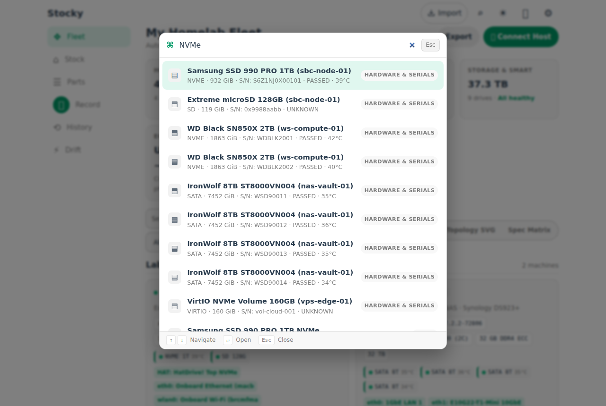

# Stocky

[](https://github.com/hexawulf/stocky/actions/workflows/ci.yml)
[](https://hub.docker.com/r/0xwulf/stocky)
[](https://hub.docker.com/r/0xwulf/stocky)
[](https://github.com/hexawulf/stocky/blob/main/LICENSE)

**Auto-discover every machine in your fleet, visualize your entire hardware topology, and track every spare part and swap in one self-hosted container.**

Stocky is a mobile-first, self-hosted homelab hardware tracker and spare parts ledger:
spare parts at one or more sites, what's on its way between them (In transit),
what's installed in which machine, and a live visual representation of your entire
hardware fleet (Rack & Chassis Cards, Interactive Topology SVG, Host Hardware Anatomy
Inspector, Spec Matrix, and a global `⌘K` Command Palette). Every stock change is a
dated movement, validated on the server in one transaction, and the most recent
movement or discovery import can be undone within 24 hours.

One container: [PocketBase](https://pocketbase.io) (auth, SQLite, API rules,
realtime SSE) serving a Vue 3 app. No cloud services, no telemetry.

Source, issues and docs: **[github.com/hexawulf/stocky](https://github.com/hexawulf/stocky)**

| Fleet Rack & Chassis View | Interactive Fleet Topology SVG |
| :---: | :---: |
|  |  |
| **Host Hardware Anatomy Inspector** | **Global `⌘K` Command Palette & Serial Search** |
|  |  |

## What's new in v1.2.0

- **Public Landing Page (`/welcome`):** Signed-out visitors to `/` see a fast, same-origin public overview (features, screenshots, Docker Compose / `docker run` quick-start, and direct **Sign in** button) while signed-in users land straight on **Fleet** and deep links preserve `/login?redirect=…`.
- **WCAG AA Contrast, UI & Mobile Polish:** Upgraded light/dark contrast tokens, restored `.btn-secondary` borders across views and dialogs, replaced missing-glyph Unicode symbols with crisp icons, fitted all 5 Fleet KPI cards on one desktop row, and eliminated 390 px mobile horizontal overflow on Settings.

### Earlier in v1.1.0

- **Global `⌘K` / `Ctrl+K` Command Palette:** Instant fuzzy search from any screen (`⌘K`, `Ctrl+K`, or top-bar `⌕` button) across every **Host**, physical **Drive by Serial Number**, **GPU**, **NIC MAC / IPv4**, **Part Type**, and **Quick Actions**.
- **Light / Dark / System Theme Toggle:** 1-click top-bar theme switcher (`☀` / `☾`) plus a `System / Light / Dark` selector in Settings (`/settings`).
- **Fleet-First Navigation:** **Fleet** (`/` and `/fleet`) is the primary landing view, with **Stock** (`/stock` — spare stock per site, low-stock alerts, and installed units) second in the navigation bar.
- **Hardened Multi-Platform Discovery (`stocky-collect.sh` v2.0 + `stocky-fleet-pull.sh`):** First-class support for bare-metal Linux, Raspberry Pi 4/5 (`arm64`), Cloud KVM VPSes, Synology DSM NASes (`synoinfo.conf` + `/sys/block` + Synology `smartctl`), and Windows WSL2 hosts (`/usr/lib/wsl/lib/nvidia-smi`).

## Quick start

```sh
mkdir -p pb_data
sudo chown 1000:1000 pb_data          # the container runs as uid/gid 1000
docker run -d --name stocky --restart unless-stopped \
  -p 8080:8080 -v "$PWD/pb_data:/pb/pb_data" 0xwulf/stocky:latest

# first superuser (PocketBase dashboard admin)
docker exec -it stocky /pb/pocketbase superuser upsert you@example.com 'a-long-password'
```

The data directory must exist before the first start and be writable by uid
1000, or PocketBase can't create its database.

Until a superuser exists, PocketBase prints a one-time install link with a
token in the container log (`docker logs stocky`). **Treat that link as a
secret.** Anyone who opens it can create the admin account. Create the
superuser right after the first start, as shown above.

Then open `http://<host>:8080/_/` (the dashboard), create your user account
(there is no public sign-up), and sign in at `http://<host>:8080/`. On a new
instance, click **Load Demo Fleet** on `/` to explore a 4-node visual
homelab showcase right away, or click **+ Connect Host** to generate an
ingest token and discover your real machines.

## Docker Compose

```yaml
services:
  stocky:
    image: 0xwulf/stocky:1.2.0 # or :latest; pin X.Y.Z to update deliberately
    container_name: stocky
    restart: unless-stopped
    ports:
      - '127.0.0.1:5030:8080' # put a TLS reverse proxy in front
    volumes:
      - ./pb_data:/pb/pb_data
    mem_limit: 128m
```

```sh
mkdir -p pb_data && sudo chown 1000:1000 pb_data
docker compose up -d
docker exec -it stocky /pb/pocketbase superuser upsert you@example.com 'a-long-password'
```

## Tags and platforms

| Tag      | Meaning                                         |
| -------- | ----------------------------------------------- |
| `1.2.0`  | one exact release (recommended for production)  |
| `1.2`    | the newest patch release of the 1.2 minor line  |
| `latest` | the newest release (pre-releases never move it) |

- Platforms: `linux/amd64` and `linux/arm64` (Raspberry Pi 4/5) in one
  multi-arch manifest.
- Images are built and pushed by
  [GitHub Actions](https://github.com/hexawulf/stocky/actions/workflows/release.yml)
  from GPG-signed git tags, only after the full test suite and Trivy security gate pass.
- Each image carries **SBOM** and **SLSA provenance** attestations:
  `docker buildx imagetools inspect 0xwulf/stocky:latest --format '{{ json .Provenance }}'`
  (or `.SBOM`).
- OCI labels give the version, the source commit (`org.opencontainers.image.revision`)
  and the bundled PocketBase version (`io.pocketbase.version`).

## Container details

| Item        | Value                                                                  |
| ----------- | ---------------------------------------------------------------------- |
| Port        | `8080` (app, API `/api/`, collector `/tools/stocky-collect.sh`, `/_/`) |
| Volume      | `/pb/pb_data`: SQLite database and settings. All state lives here.     |
| User        | non-root `stocky`, uid/gid `1000`                                      |
| Healthcheck | `GET /api/health` every 30 s                                           |
| Base        | Alpine; PocketBase release binary verified against its `checksums.txt` |
| Size        | about 17 MB compressed, 20–40 MiB RAM idle                             |

Migrations apply on start, so **back up `pb_data` before upgrading** to a
release that changes the schema (see the
[changelog](https://github.com/hexawulf/stocky/blob/main/CHANGELOG.md)).

**Reverse proxy:** serve Stocky over HTTPS on its own hostname. Realtime updates
use **server-sent events (SSE)**: turn off response buffering for the proxied
location (nginx: `proxy_buffering off;`, `proxy_http_version 1.1;`,
`proxy_set_header Connection '';`, a long `proxy_read_timeout`), or changes
appear only after a reload. A full nginx example, trusting `X-Forwarded-For`,
mail (SMTP for password reset) and backups are in
[docs/deploy.md](https://github.com/hexawulf/stocky/blob/main/docs/deploy.md#behind-a-reverse-proxy).

## Automated Hardware Discovery & Visual Topology

[`tools/stocky-collect.sh`](https://github.com/hexawulf/stocky/blob/main/tools/README.md)
(also served directly from your container at `/tools/stocky-collect.sh` alongside
`/tools/stocky-collect.sh.sha256`) reads bare-metal Linux machines, Raspberry Pi
SBCs, Cloud KVM VPSes, Synology DSM NASes, and WSL2 instances into a
`stocky.discovery/2` JSON snapshot.

- **Automated Push (`--push`):** Authenticates with a scoped `stky_...` token
  (stored as a SHA-256 hash in PocketBase). Live telemetry (`lastSeenAt`, OS/kernel,
  CPU/RAM/storage summaries, SMART temperatures) updates automatically, while
  physical hardware changes queue in the **Drift Inbox (`/fleet/drift`)** for 1-click
  transactional review and 24-hour undo.
- **Central SSH Pull (`tools/stocky-fleet-pull.sh`):** Streams the collector
  read-only over SSH for NASes or isolated hosts and pushes each snapshot to Stocky.
- **Shareable Visual Exports:** Export your fleet topology as standalone **SVG**,
  **2× PNG**, **Markdown Spec Matrix**, or **JSON** with **Privacy Redaction ON by
  default** (strips serial numbers, MAC addresses, `machineIdHash`, and costs).

## Links

- GitHub: https://github.com/hexawulf/stocky
- Security policy: https://github.com/hexawulf/stocky/blob/main/SECURITY.md
- Specification: https://github.com/hexawulf/stocky/blob/main/spec.md
- Deployment guide: https://github.com/hexawulf/stocky/blob/main/docs/deploy.md
- Seed presets: https://github.com/hexawulf/stocky/blob/main/docs/presets.md
- Changelog: https://github.com/hexawulf/stocky/blob/main/CHANGELOG.md
- Issues: https://github.com/hexawulf/stocky/issues
- Licence: [MIT](https://github.com/hexawulf/stocky/blob/main/LICENSE)
